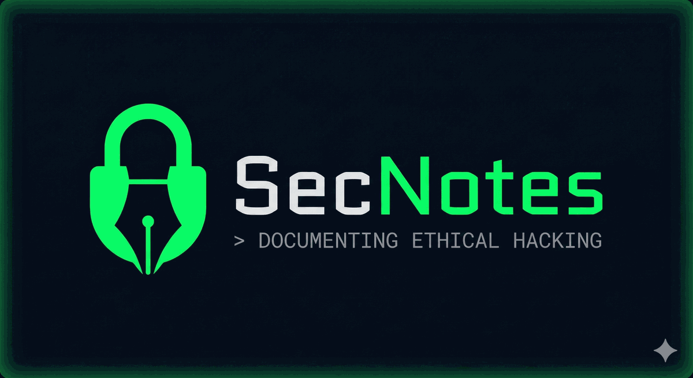

# 🔒 SecNotes | Cybersecurity Writeups & Documentation

  

  <strong>Bitácora personal de Hacking Ético, Auditoría Ofensiva (Red Team) y Fortificación de Sistemas (Blue Team).</strong>

  <a href="https://yorve.github.io/secnotes/">🌐 Visitar el Blog en Vivo</a>

## 🚀 ¿Qué es SecNotes?

**SecNotes**  Este espacio nació con el objetivo de centralizar, estructurar y documentar de manera didáctica mis notas de estudio, laboratorios técnicos y guías formativas orientadas al sector de la seguridad informática en español.

## 📁 Estructura del Arsenal (Etiquetas principales)

El contenido se divide dinámicamente en cuatro grandes frentes tácticos:

*   **`[#] PLATAFORMAS`:** Resolución detallada (*writeups*) de laboratorios en DockerLabs, HackTheBox, TryHackMe, entre otras.
*   **`[#] SISTEMAS`:** Guías de explotación y evasión en entornos Linux, Windows, contenedores (LXC/LXD) y Cloud (AWS).
*   **`[#] RED TEAM`:** Técnicas de explotación web, pivoting, escalada de privilegios (SUID, scripts) y análisis de vulnerabilidades (CVEs).
*   **`[#] BLUE TEAM`:** Hardening de servidores, análisis forense de memoria, gestión de logs y auditoría defensiva de redes.

## Noticias de IA

La acción **Borrador de noticias de IA** se ejecuta los martes y viernes a las 09:17 (hora de Santiago). También se puede iniciar desde **Actions → Borrador de noticias de IA → Run workflow**.

Configura el secreto `OPENAI_API_KEY` en GitHub Actions para redactar los resúmenes en español con la API de OpenAI. Si hay novedades con información suficiente, el archivo Markdown estará en el artefacto **borrador-noticias-ia** de la ejecución.

Para publicar un boletín, descarga el Markdown, contrasta los enlaces y resúmenes con las fuentes y edita los campos que necesites. Guarda después el archivo aprobado en `_boletines/` con su nombre fechado y publica mediante el flujo habitual de GitHub Pages. Si ya existe una edición de esa fecha, revisa los dos archivos antes de incorporar novedades al boletín publicado.
