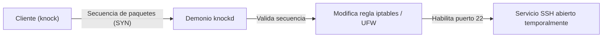

En este writeup detallado vamos a resolver la máquina **Los 40 Ladrones** de la plataforma **DockerLabs**. 

Este laboratorio presenta un reto interesante: el servicio SSH se encuentra oculto tras una regla de firewall. Para vulnerar la máquina, debemos descubrir la secuencia de **Port Knocking** filtrada en el servicio web, realizar un ataque de fuerza bruta con **Hydra** y finalmente escalar privilegios mediante un binario `bash` con permisos **SUID** generado por el demonio `knockd`.

---

## 1. Fase de Reconocimiento y Enumeración de Puertos

Iniciamos la fase de reconocimiento mediante un escaneo automatizado con la herramienta **AutoRecon** para identificar puertos abiertos y servicios activos:


El resultado revela únicamente el puerto web 80 (HTTP) abierto. Una enumeración rápida con Gobuster no arroja rutas críticas a primera vista:


Al inspeccionar el servicio web en el navegador, observamos la página de inicio por defecto de Apache:


Revisamos el código fuente y comentarios HTML utilizando `curl`:


### Fuzzing de Directorios Web con Gobuster

Lanzamos un escaneo exhaustivo de directorios y extensiones comunes:


El escaneo descubre el archivo `qdefense.txt`. Al visualizar su contenido encontramos una pista determinante:


---

## 2. Análisis Técnico: ¿Qué es Port Knocking?

La pista *"Recuerda, llama antes de entrar"* hace referencia directa a **Port Knocking**. 

El Port Knocking es una técnica de defensa en red que mantiene puertos críticos cerrados en el firewall hasta que el cliente envía una secuencia matemática exacta de paquetes de conexión a puertos cerrados.



### Funcionamiento del Mecanismo
1. **Estado Inicial:** El puerto SSH (22) permanece filtrado por el firewall.
2. **Secuencia de Golpes:** El atacante o administrador envía paquetes a los puertos definidos en el orden exacto usando el cliente `knock`.
3. **Apertura Dinámica:** El demonio `knockd` detecta la secuencia correcta y añade una regla dinámica en el firewall para admitir la IP de origen.
4. **Cierre Automático:** Al expirar el tiempo de sesión, el firewall restaura el bloqueo.

Referencias técnicas adicionales:
- [ArchWiki - Port Knocking](https://wiki.archlinux.org/title/Port_knocking)
- [Manual Oficial de Knockd](https://linux.die.net/man/1/knockd)

---

## 3. Explotación y Acceso Inicial (Foothold)

El mensaje encontrado revela la secuencia de puertos y un usuario potencial llamado `toctoc`:


Enviamos los paquetes requeridos mediante el cliente `knock`:

```bash
knock <IP_OBJETIVO> <PUERTO_1> <PUERTO_2> <PUERTO_3>
```


El comando no genera respuesta visual. Sin embargo, al relanzar un escaneo con Nmap confirmamos que el puerto **22 (SSH)** está ahora en estado **abierto**:


### Fuerza Bruta SSH con Hydra

Con el usuario `toctoc` confirmado, lanzamos un ataque de diccionario empleando el listado `rockyou.txt`:

```bash
hydra -l 'toctoc' -P ~/Downloads/rockyou.txt 172.17.0.2 ssh
```

- `-l 'toctoc'`: Define el usuario objetivo.
- `-P rockyou.txt`: Especifica la ruta del diccionario de contraseñas.


Hydra descubre la credencial válida en pocos segundos. Conectamos por SSH al servidor:


---

## 4. Escalada de Privilegios a Root

Dentro de la sesión de `toctoc`, procedemos a la enumeración de privilegios de ejecución (`sudo -l`):


Identificamos una entrada directa al binario `/opt/bash`. Ejecutamos la llamada elevando privilegios:

```bash
sudo -u root /opt/bash
```


Accedemos con privilegios de **root**.

---

## 5. Análisis Post-Explotación del Demonio `knockd`

Investigamos el proceso del demonio `knockd` en ejecución:

```bash
root@4ffcaf3103b7:/home/toctoc# ps aux | grep "knockd"
root           1  0.0  0.0   4332  3292 ?        Ss   04:21   0:00 /bin/bash -c service ufw start ; service ssh start ; service knockd start ; service apache2 start ; while true; do echo 'Alive'; sleep 60; done
root          71  0.0  0.0   9888  3728 ?        Ss   04:21   0:00 /usr/sbin/knockd -d -i eth0
root         630  0.0  0.0   3964  2176 pts/1    S+   05:03   0:00 grep --color=auto knockd
```


Examinamos la configuración del servicio y descubrimos el script automatizado:


### Vulnerabilidades Técnicas Detectadas:
1. `cp /bin/bash /opt/bash`: Genera una réplica del intérprete de comandos en `/opt`.
2. `chmod +s /opt/bash`: Asigna el bit **SUID**. Debido a que el script corre bajo el contexto del usuario root, el binario resultante otorga una shell privilegiada instantánea.

---

## 6. Lecciones Aprendidas y Mitigaciones

- **Seguridad por Oscuridad:** Port Knocking añade una capa de ofuscación, pero nunca sustituye la autenticación robusta. La fuga de datos en `qdefense.txt` inutilizó toda la protección.
- **Gestión de Contraseñas:** Se deben aplicar directivas de contraseñas robustas y desactivar el acceso SSH por contraseña en favor de autenticación obligatoria por claves públicas Ed25519 o RSA.
- **Peligro de Binarios SUID Innecesarios:** Ningún script de mantenimiento debe asignar bits SUID a intérpretes de comandos (`bash`, `sh`, `python`). 

---

### 🛡️ Otros Laboratorios y Writeups Relacionados
- [TheHackerLabs: Kaboom - Walkthrough y Writeup](/secnotes/2026/10/24/TheHackerLabs-Kaboom.html)
- [TheHackerLabs: Rockstar - Guía de Explotación](/secnotes/2026/10/29/TheHackerLabs-Rockstar.html)
- [Serie de Hardening en Metasploitable 2](/secnotes/metasploitable2)
